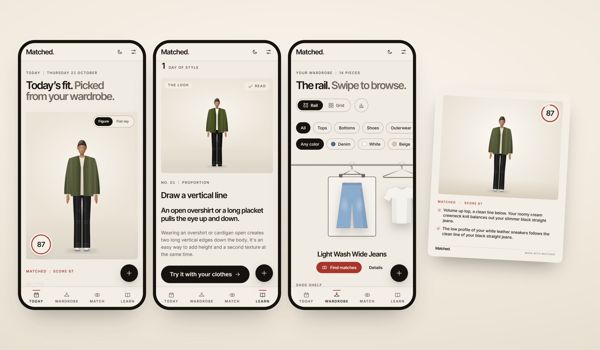

<p align="center">
  
</p>

# Matched

**Photograph your clothes once. Matched shows you what pairs with what, and tells you why in one plain sentence.**

It's an open-source wardrobe stylist that runs in your browser. There are no accounts, and your clothes never leave your phone.

**Live demo:** _coming with the first deploy_ · **License:** AGPL-3.0 · **Status:** v1. Menswear is complete; womenswear is early.

---

## What it does

- **Today's fit.** Every morning you get one outfit from your own wardrobe, worn on a mannequin that matches your height, build, skin tone and hair. Tap *Wear this* and those pieces rest for a few days.
- **Match.** Swipe each slot (top, bottom, shoes, layer) and watch the score move. *Match it for me* fills in the best combination. *I own…* starts from a few pieces and shows every outfit they make.
- **The rail.** Your clothes hang on a rail you can swipe. Tap *Find matches* on any piece.
- **Learn.** 37 short lessons on proportion, shoes, color and formality, picked for your height and goals. Each one ends with *Try it with your clothes*.
- **Gap Finder.** Shows the one basic piece that would unlock the most new outfits, for example "A pair of beige chinos would unlock 20 new outfits." It never links to a shop.
- **Share cards and stats.** Export any outfit as a 1080×1350 image. See every outfit your wardrobe can make, your most versatile piece and your color mix.
- **Installable and offline.** Add Matched to your home screen and it opens full screen. Everything except AI photo tagging works without a connection.

## Run it locally

You need Node 20.9 or newer.

```bash
git clone https://github.com/<you>/matched.git && cd matched && npm install && npm run dev
```

Open http://localhost:3000 and tap **Try a sample wardrobe** to see it working before you photograph anything.

| Command | What it does |
| --- | --- |
| `npm run dev` | Development server |
| `npm test` | The test suite, including one test for every style rule and lesson |
| `npm run typecheck` / `npm run lint` | TypeScript and ESLint |
| `npm run build && npm start` | Production build. The service worker only runs here. |

## Photo tagging with Claude (optional)

When you add a photo, Matched removes the background in the browser and then needs tags: category, fit, color, formality and so on. It gets them in this order:

1. **Your own Anthropic API key.** Paste it in **Settings → Photo tagging**. It's stored only in IndexedDB on your device, and photos go straight from your browser to Anthropic (`claude-haiku-5-5`). Nothing passes through a Matched server.
2. **The demo key.** For a hosted demo only. Set `NEXT_PUBLIC_DEMO_MODE=true` and `ANTHROPIC_API_KEY` on the server. The `/api/tag` route is rate-limited and returns 404 when demo mode is off.
3. **By hand.** Without either, you confirm the tags with a few taps. The colors are still detected automatically.

Copy `.env.example` to `.env.local` for the demo settings. Never commit keys; `.env.local` is git-ignored.

## How the rules engine works

There is no AI in the styling. Every score comes from a small set of deterministic rules written in plain TypeScript, so the same outfit always gets the same answer, and every answer can be explained.

```
photo ─▶ tags (Claude or you) ─▶ rules engine ─▶ score + 2–4 reasons
                                     ▲
                    your track, height and goals
```

- **Rules** live in [`rules/`](rules/): [`shared.ts`](rules/shared.ts) for everyone, [`menswear.ts`](rules/menswear.ts) and [`womenswear.ts`](rules/womenswear.ts) per track. Each rule looks at the outfit and either stays quiet or fires with a sentence.
- **Data** is kept apart from logic. Color families and harmony live in [`rules/colors.ts`](rules/colors.ts), garment volumes in [`rules/garments.ts`](rules/garments.ts), and every threshold and weight in [`rules/tuning.ts`](rules/tuning.ts).
- **Scoring:** a base of 55, plus rewards on a diminishing curve (up to +45), minus penalties. 75 and over is *Matched*, 55 to 74 *Works*, below 55 *Rethink*. The strongest two to four reasons are shown, warnings first.
- **Personalisation:** your height band (shorter, average or taller than your track's average) and your goals scale groups of rules. Someone who wants to look taller gets more credit for tonal outfits; a tall frame is penalised less for volume.
- **Lessons** in [`content/lessons/`](content/lessons/) point at the rules they teach. The Gap Finder's shopping list lives in [`rules/gaps.ts`](rules/gaps.ts).

## Add a style rule

1. **Write it** in the right file in [`rules/`](rules/). Here's a real one:

   ```ts
   {
     id: 'color.leg-line',
     kind: 'color',                // proportion | shoes | color | formality
     effect: 6,                    // points; negative for a warning
     tags: ['leg-line', 'tonal'],  // lets height and goals scale it
     text: 'Matching your {shoes} to your {bottom} carries the color down to the floor and lengthens the leg.',
     when: (ctx) => {
       const { bottom, shoes } = ctx;
       if (!bottom || !shoes || !hasLegs(bottom)) return false;
       return ctx.color(bottom).tone === ctx.color(shoes).tone;
     },
   },
   ```

   `when` gets the outfit already sorted into `top`, `bottom`, `shoes`, `outerwear` and `onepiece`, with resolved colors. It returns `false` to stay quiet, or `true` (or extra `{slots}`) to fire.

2. **Write the sentence in the Matched voice:** a friendly stylist, one sentence, no jargon, never judging bodies. Put slots after "your", "of" or "with" so verbs never have to agree with them.

3. **Test it** in [`lib/rules/rules.test.ts`](lib/rules/rules.test.ts). Give one outfit where it fires and one where it doesn't. The suite fails if any rule is missing a test.

4. **Check the calibration:** `npm test` also scores 24 known outfits ([`lib/rules/outfits.test.ts`](lib/rules/outfits.test.ts)). If your rule moves one of them across a verdict line, adjust the effect or the expectation and explain why in the PR.

To add a **lesson**, add an entry to a file in `content/lessons/`. The tests check that its example look can be drawn on the mannequin, scores at least 62, and fires one of the rules it names.

More in [CONTRIBUTING.md](CONTRIBUTING.md).

## Under the hood

- **Next.js 16** (App Router, all pages static), **React 19**, **TypeScript**, **Tailwind v4**
- **Design tokens** for every color, size, radius, shadow, easing and z-index, in [`styles/tokens.css`](styles/tokens.css), with light and evening editions
- **Dexie / IndexedDB** for all data, on the device
- **Motion** for animation; everything respects *reduce motion*
- **@imgly/background-removal** (quantised ISNet) for cutouts in the browser, and k-means in Lab space for colors
- A **parametric SVG mannequin** whose garments morph between shapes, so the same figure wears every outfit
- A **service worker** for offline use and install, and a canvas renderer for share cards

## Privacy

Matched has no accounts, no analytics and no backend database. Your photos, wardrobe, outfits, streak and API key live in your browser's storage on your device. **Settings → Clear all data** removes all of it.

## Built with

- **[Claude](https://claude.ai)** by Anthropic. Claude Code wrote the app alongside the author, and Claude Haiku tags clothing photos.
- **Dessn** for visual design passes on the token-based UI.
- [Inter and Inter Tight](https://rsms.me/inter/) by Rasmus Andersson, and [IMG.LY background removal](https://github.com/imgly/background-removal-js).

## License

[AGPL-3.0](LICENSE.md). If you run a modified Matched as a service, share your changes.
